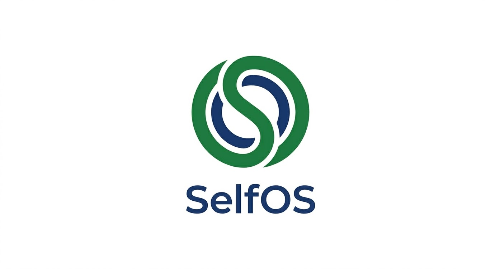

<div align="center">



### **内在心灵的数字加速器 · 模拟自性之径**
*A Digital Accelerator for the Inner Soul, Simulating the Path of Individuation*

[](https://en.wikipedia.org/wiki/Individuation)
[]()
[]()
[]()
[](./LICENSE)

</div>

---

## ⚡ 项目概述

**selfOS** 是一款探索个体「自性化」（Individuation）路径的深度仿真引擎。它旨在将碎片化的数字记忆、生命叙事与深层心理结构相结合，在 **卡巴拉生命之树** 的拓扑逻辑中构建出一个高保真的"内在心理剧场"。

系统通过将复杂的心理动力学参数化，驱动代表不同内在能量的智能体进行模拟博弈。其核心价值在于揭示潜意识中的涌现行为，帮助个体识别内在阻力并寻找动态平衡。

> **"理解'为什么'比知道'是什么'更有决策价值。"**

---

## 🔄 核心工作流：四世界流水线

selfOS 的运行逻辑遵循卡巴拉的"四世界"演化模型，将原始数据逐层升华为觉察：

| 阶段 | 四世界 | 核心动作 |
|:---:|:---:|:---|
| **1** | **神性界 (Atzilut)** — 意志 | 确立自性化核心意图；从用户生命素材（日记、对话、命盘数据）中提取本体论实体与关系；定义全局 Agent 的原始动力与偏好 |
| **2** | **创造界 (Beria)** — 结构 | 利用 **GraphRAG** 技术构建生命叙事图谱；自动提取核心信念簇与情感锚点；注入个体与集体记忆（八字命盘、Vedic星盘作为"先天记忆"） |
| **3** | **形成界 (Yetzirah)** — 演化 | 内在议会博弈阶段；代表限制、创造、阴影与观察者的智能体在模拟空间内进行多轮交互；天文历法周期（大运、流年、Dasha）作为时序驱动变量 |
| **4** | **物质界 (Assiya)** — 显现 | 输出多维分析报告；通过实时监测关键变量反馈心理能量流向；支持与任意内在Agent对话 |

---

## 🏗️ 系统架构

项目采用前后端解耦的模块化设计，确保心理逻辑与计算架构的高度解耦：

```
selfOS/
├── frontend/                    # Vue 3 + TypeScript 前端 (port 3000)
│   ├── src/
│   │   ├── views/
│   │   │   ├── SeedUpload/      # 生命素材上传（日记、命盘数据）
│   │   │   ├── GraphBuilder/    # 生命之树图谱可视化
│   │   │   ├── Simulation/      # 内在议会实时仿真
│   │   │   ├── ChartCasting/    # 八字/Vedic 排盘交互界面
│   │   │   └── Report/          # 自性化报告 & Agent 对话
│   │   ├── components/
│   │   │   ├── SephirothMap/    # 生命之树十原质交互图
│   │   │   ├── BaZiChart/       # 八字排盘可视化组件
│   │   │   ├── VedicChart/      # Vedic 星盘（南印/北印格式）
│   │   │   └── EnergyFlow/      # 路径能量流动动画
│   │   └── stores/              # Pinia 状态管理
│   └── package.json
│
├── backend/                     # Python/Flask 后端 (port 5001)
│   ├── app/
│   │   ├── blueprints/
│   │   │   ├── graph/           # GraphRAG 图谱构建 API
│   │   │   ├── simulation/      # 仿真引擎 API
│   │   │   ├── divination/      # 排盘计算 API（八字 + Vedic）
│   │   │   └── report/          # 报告生成 API
│   │   ├── engines/
│   │   │   ├── oasis_adapter/   # OASIS 多Agent仿真引擎适配层
│   │   │   ├── archetype/       # 原型Agent实例化引擎
│   │   │   ├── bazi/            # 八字排盘引擎
│   │   │   ├── vedic/           # Vedic占星计算引擎
│   │   │   └── ephemeris/       # Swiss Ephemeris 天文历法层
│   │   ├── graph/
│   │   │   ├── knowledge_graph/ # GraphRAG 知识图谱
│   │   │   ├── sephiroth/       # 生命之树拓扑结构
│   │   │   └── memory/          # Zep Cloud 长期记忆管理
│   │   └── models/
│   │       ├── psyche_params/   # 心理动力学参数模型
│   │       └── astro_params/    # 天文历法参数模型
│   ├── pyproject.toml
│   └── requirements.txt
│
├── ephe/                        # Swiss Ephemeris 星历数据文件
│   ├── sepl_18.se1              # 行星星历 1800-2400 AD
│   ├── semo_18.se1              # 月球星历
│   └── seas_18.se1              # 小行星星历
│
├── docker-compose.yml
├── Dockerfile
└── .env.example
```

### 分层架构

| 层级 | 模块 | 技术栈 | 说明 |
|:---:|:---:|:---:|:---|
| **感知层** | Perception Engine | LLM + NLP Pipeline | 将非结构化文本（如日记，微博，社交媒体记录/手动给Agent输入信息整理/GPT聊天文档导入/梦境记录/微博微信账号）转化为结构化心理图谱 |
| **感知层** | Divination Engine | Swiss Ephemeris + pyswisseph + PyJHora | 八字排盘与 Vedic 星盘计算 |
| **认知层** | Agent Council | OASIS Framework (CAMEL-AI) | 基于荣格原型构建多智能体系统：自我（Ego，执行与决策）/ 阴影（Shadow，被压抑内容）/ 人格面具（Persona，社会适应）/ 阿尼玛-阿尼姆斯（内在对立性别原型）/ 自性（Self，整体整合中心） |
| **认知层** | Long-term Memory | Zep Cloud / Neo4j | 构建跨时间的认知追踪系统：<br>• 命盘作为先天数据输入<br>• 事件节点时间线记录（重大事件/梦境/心理转折）<br>• 支持长期模式识别 |
| **逻辑层** | Dynamic Topology Router | 自研通信协议 | 基于生命之树 22 路径构建通信机制；结合大运、流年、Dasha 周期动态调整路径权重 |
| **逻辑层** | Release Protocol | FSM + LLM 意图识别 | 情绪干预机制：<br>• Step 1（CBT）：提取「触发事件 → 自动思维 → 核心信念」<br>• Step 2（释放）：观察者 Agent 介入，识别深层匮乏（控制、认同、安全、生存）<br>• 动态调整系统参数：Grip（抓取度）、Resistance（抗拒度） |
| **逻辑层** | Parametric Model | LLM-as-Judge + 数值优化 | 使用参数驱动决策：Grip、Resistance、五行分值、Shadbala 等作为权重输入 |
| **表现层** | Visualization Interface | D3.js + Three.js + ECharts | 动态可视化：<br>• 原型之间的张力关系<br>• 命盘与能量结构图<br>• 交互式数据展示 |
| **认知层** | Shadow Field | Latent Variable Model | 对阴影进行结构化建模（非固定 Agent）：<br>• 表示被压抑内容与未整合心理状态<br>• 通过异常检测或情绪偏移动态触发<br>• 作为系统扰动源输入 Individuation Engine |
| **元认知层** | Observer Monitor | Meta-cognition Module | 对系统整体状态进行监控与标注：<br>• 记录冲突、情绪波动、Agent 分歧<br>• 将无意识过程转化为可解释状态<br>• 不参与决策，仅提供意识化输入 |
| **核心层** | Self | Global Controller / Attractor Model | 系统统一中心：<br>• 负责整合多 Agent 输出与冲突<br>• 维持长期人格一致性与稳定性<br>• 动态调整系统目标与权重分布 |
| **逻辑层** | Individuation Engine | FSM + LLM + Optimization | 自性化过程引擎：<br>• Step 1（冲突检测）：识别 Agent 分歧与 Shadow 激活<br>• Step 2（意识化）：Observer 转换为可解释心理状态<br>• Step 3（意义生成）：Tiphereth 提取深层动机与核心需求<br>• Step 4（整合）：Self 重新分配权重与系统结构<br>• Step 5（更新）：写入 Memory 并调整 Grip、Resistance 等参数 |

---

## 🔮 占星与命理引擎（新增模块）

selfOS 独创性地将东西方占星体系作为**先天参数注入层**，为内在Agent提供"出生条件"初始化数据，而非简单的算命工具。

### 八字排盘引擎 (BaZi Engine)

基于 `lunar_python` 与自研排盘算法，提供完整的四柱八字分析能力：

| 功能 | 说明 | 技术实现 |
|:---|:---|:---|
| 四柱排盘 | 年柱、月柱、日柱、时柱自动计算 | 天干地支万年历算法；支持公历/农历输入 |
| 五行分析 | 金木水火土量化打分 | 基于藏干权重的五行力量计算 |
| 十神关系 | 正官、七杀、正印、偏印等十神推导 | 日主与各柱干支的生克关系矩阵 |
| 大运流年 | 十年大运与逐年流年排列 | 节气精确计算（Swiss Ephemeris 辅助） |
| 冲刑合会 | 地支关系自动标注 | 三合、六合、三会、相冲、相刑、相害完整检测 |
| 神煞标注 | 天乙贵人、驿马、桃花等常用神煞 | 经典命理规则库 |

**与 selfOS 的整合逻辑：** 八字五行分值直接映射为 Agent 的初始能量分配权重。例如，命局水旺火弱的用户，其"创造者"Agent（对应火元素/Netzach）将以较低的初始活跃度启动仿真，而"智慧者"Agent（对应水元素/Hod）则获得更高的初始权重。

### Vedic 占星引擎 (Jyotish Engine)

通过 [PyJHora](https://github.com/naturalstupid/PyJHora)（Jagannatha Hora 的 Python 移植）与 Swiss Ephemeris 提供 Vedic 占星分析：

| 功能 | 说明 | 技术来源 |
|:---|:---|:---|
| Rashi Chart (D1) | 本命盘计算（南印/北印格式） | PyJHora + Swiss Ephemeris (DE431) |
| Navamsa (D9) | 第九分盘——灵魂层面分析 | PyJHora divisional chart 模块 |
| Dashamsa (D10) | 第十分盘——事业使命分析 | PyJHora divisional chart 模块 |
| Vimshottari Dasha | 120年大周期系统 | PyJHora dasha 模块 |
| Yogini/Chara Dasha | 替代 Dasha 系统 | PyJHora 多 Dasha 支持 |
| Shadbala | 六种行星力量（位置力、方向力等） | PyJHora bala 模块；与 BV Raman 结果校验 |
| Ashtakavarga | 八大行星过运评分系统 | PyJHora ashtakavarga 模块 |
| Muhurta | 择时择日 | PyJHora muhurta + Panchanga |
| 20+ Ayanamsa 支持 | Lahiri, KP, True Chitra 等 | PyJHora const 模块 |

**与 selfOS 的整合逻辑：** Vimshottari Dasha 的当前大期/小期/细期直接作为仿真的**时序调制器**——当用户正处于土星大期（Sade Sati），"防御者/限制者"Agent 的活跃度权重自动上调，模拟"土星式"的心灵压力测试。

### Swiss Ephemeris 天文层

作为底层天文计算引擎，提供高精度星历数据：

| 特性 | 说明 |
|:---|:---|
| 数据源 | NASA JPL DE431 星历压缩版（原始 2.8GB → 99MB） |
| 精度 | 0.001 角秒（毫角秒级） |
| 时间范围 | 13201 BC — 17191 AD（完整版） |
| Python 绑定 | `pyswisseph` (PyPI) — 基于 Swiss Ephemeris C 库 |
| Node.js 绑定 | `sweph` (npm) — 用于前端实时预览计算 |
| 授权 | AGPL-3.0（开源项目）/ Professional License（商用） |
| 核心功能 | 行星经纬度、恒星位置、日月食、升降时刻、Julian Day 转换 |

**API 调用示例：**
```python
import swisseph as swe

swe.set_ephe_path('./ephe')  # 设置星历文件路径
jd = swe.julday(1990, 5, 15, 12.0)  # 出生时间 → Julian Day
sun_pos = swe.calc_ut(jd, swe.SUN)  # 太阳位置（黄经、黄纬、距离、速度）
moon_pos = swe.calc_ut(jd, swe.MOON)  # 月球位置
# → 供八字节气精算 & Vedic 行星位置使用
```

---

## 🌑 系统深度逻辑：阴影检测与自性整合

selfOS 的独特之处在于对"非平衡状态"的监测。通过引入**阴影探测模块**，系统能够捕捉被压抑或忽视的情绪簇：

- **路径监测**：实时分析 22 条路径的流量分配，识别能量滞留点
- **变量分析**：引入 $Grip$（抓取度）与 $Resistance$（抗拒度）作为动态参数，量化心理执着程度
- **命理校验**：将路径滞留点与八字忌神/Vedic 凶星位置交叉比对，识别"先天阴影模式"
- **自性化反馈**：通过模拟释放变量后的系统涌现结果，引导用户探索潜在的整合路径

### 参数融合模型

```
Agent 决策权重 = f(
    GraphRAG 叙事分析权重,        // 后天经历层
    BaZi 五行分值,                // 先天能量配置
    Vedic Shadbala 行星力量,      // 先天行星力量
    Dasha 当前周期系数,           // 时序调制
    大运/流年干支互动系数,        // 时序调制（东方体系）
    实时路径流量反馈              // 动态校正
)
```

---

## 🛠 技术栈总览

| 类别 | 技术 | 用途 |
|:---|:---|:---|
| **前端** | Vue 3 + TypeScript + Vite | 步骤引导式交互界面 |
| **后端** | Python 3.11 + Flask | 异步任务管理、长时运算 |
| **LLM** | OpenAI-compatible API (Qwen/GPT/Claude) | Agent 决策、叙事分析、报告生成 |
| **图谱** | GraphRAG + Neo4j / Zep Cloud | 生命叙事知识图谱 & Agent 长期记忆 |
| **仿真** | OASIS (CAMEL-AI) | 多Agent社会仿真框架（支持百万级Agent） |
| **八字** | lunar_python + 自研排盘算法 | 四柱计算、五行分析、大运流年 |
| **Vedic** | PyJHora (Jagannatha Hora Python 移植) | 全套 Vedic 占星计算（D1-D60、Dasha、Shadbala 等） |
| **天文** | Swiss Ephemeris (pyswisseph / sweph) | 高精度行星星历（DE431, 0.001″精度） |
| **可视化** | D3.js + Three.js + ECharts | 生命之树拓扑动画、排盘图表、能量流动 |
| **部署** | Docker + docker-compose | 一键部署前后端 + Neo4j + 星历数据卷 |

---

## 🚀 快速开始

### 环境要求
- Node.js ≥ 18
- Python ≥ 3.11
- Docker & Docker Compose（推荐）

### 当前可运行：前端

目前仓库中已实现前端（`frontend/`），后端尚在开发中。八字、西方占星与 Vedic 三套排盘完全在浏览器内基于 Swiss Ephemeris（WASM）计算，精度与桌面排盘软件一致；叙事图谱、仿真与报告在没有后端时使用内置演示数据，并在界面顶栏标注 “Demo data”。

```bash
git clone https://github.com/yunningtang/selfOS.git
cd selfOS
npm run setup:frontend   # 安装前端依赖
npm run dev              # 启动前端 http://localhost:3000（/api 代理到 :5001）
```

详见 [`frontend/README.md`](./frontend/README.md) 与设计系统文档 [`frontend/DESIGN.md`](./frontend/DESIGN.md)。

### 规划中：完整部署

后端、Docker 与 `.env` 配置完成后，将支持：

```bash
cp .env.example .env
# 编辑 .env 配置 LLM API Key、Neo4j 等

docker compose up -d     # 一键启动前后端 + Neo4j + 星历数据卷
```

### 环境变量

```env
# LLM 配置（支持任意 OpenAI SDK 兼容服务）
LLM_API_KEY=your_api_key
LLM_BASE_URL=https://api.openai.com/v1
LLM_MODEL_NAME=gpt-4o

# 图谱 & 记忆
NEO4J_URI=bolt://localhost:7687
NEO4J_AUTH=neo4j/selfos
ZEP_API_KEY=your_zep_key        # 可选，用于云端长期记忆

# 天文历法
EPHE_PATH=./ephe                 # Swiss Ephemeris 星历文件目录
DEFAULT_AYANAMSA=LAHIRI          # 默认 Ayanamsa（Vedic 占星用）

# 八字配置
BAZI_CALENDAR=SOLAR              # SOLAR=公历输入 / LUNAR=农历输入
BAZI_EARLY_ZI=NEXT_DAY           # 早子时配置：23:00-23:59 日干支归属
```

### 前端访问
- 前端界面：`http://localhost:3000`
- 后端 API：`http://localhost:5001`
- Neo4j Browser：`http://localhost:7474`

---

## 📡 API 概览

### 排盘 API（`/api/divination`）

```
POST /api/divination/bazi/chart
  body: { year, month, day, hour, calendar: "solar"|"lunar", gender: "M"|"F" }
  → 返回完整八字排盘（四柱、十神、五行分值、大运、神煞）

POST /api/divination/vedic/chart
  body: { year, month, day, hour, minute, latitude, longitude, timezone, ayanamsa? }
  → 返回 Vedic 本命盘 + Navamsa + 指定分盘 + Vimshottari Dasha

POST /api/divination/vedic/shadbala
  body: { ...same as above }
  → 返回七曜 Shadbala 六种力量评分

GET /api/divination/ephemeris/planet
  params: { jd, planet, flags? }
  → 返回指定 Julian Day 的行星位置（黄经、黄纬、距离、速度）
```

### 图谱 API（`/api/graph`）

```
POST /api/graph/build           # 从上传素材构建 GraphRAG
GET  /api/graph/sephiroth       # 获取生命之树拓扑 + 能量分布
POST /api/graph/inject-memory   # 注入命盘数据为先天记忆锚点
```

### 仿真 API（`/api/simulation`）

```
POST /api/simulation/start      # 启动内在议会仿真
GET  /api/simulation/status     # 获取仿真进度
POST /api/simulation/inject     # 注入外部变量（流年冲击等）
GET  /api/simulation/agents     # 获取所有 Agent 状态
POST /api/simulation/interview  # 与指定 Agent 对话
```

### 报告 API（`/api/report`）

```
POST /api/report/generate       # 生成自性化分析报告
GET  /api/report/{id}           # 获取历史报告
POST /api/report/chat           # 与 ReportAgent 对话深入分析
```

---

## 🗺️ 项目路线图

### Phase 1 — 基础设施（当前）
- [ ] 前后端解耦架构搭建（Vue 3 + Flask）
- [ ] Swiss Ephemeris 集成与天文计算层
- [ ] 八字排盘引擎核心算法
- [ ] PyJHora 适配层 & Vedic 基础星盘计算
- [ ] GraphRAG 知识图谱基础构建

### Phase 2 — 仿真引擎
- [ ] OASIS 框架集成与原型Agent定义
- [ ] 生命之树 22 路径通信协议
- [ ] 命盘参数→Agent权重映射算法
- [ ] Dasha/大运时序调制器
- [ ] 内在议会博弈核心循环

### Phase 3 — 智能分析
- [ ] ReportAgent 工具集（三层检索：深度/广度/对话）
- [ ] 阴影检测与自性化反馈算法
- [ ] 命盘-图谱交叉分析模块
- [ ] 多维可视化（生命之树 3D 渲染 + 排盘交互图表）

### Phase 4 — 生态扩展
- [ ] BaZi MCP Server（兼容 Claude / GPT Agent 调用）
- [ ] Vedic MCP Server
- [ ] 紫微斗数引擎接入
- [ ] 奇门遁甲模块
- [ ] 社区贡献的自定义 Agent 原型
- [ ] 移动端 PWA

---

## 📚 参考与致敬

| 项目/资源 | 说明 |
|:---|:---|
| [OASIS (CAMEL-AI)](https://github.com/camel-ai/oasis) | 开源多Agent社会仿真框架，支持百万级Agent扩展 |
| [Swiss Ephemeris](https://www.astro.com/swisseph/swephinfo_e.htm) | Astrodienst 高精度天文星历库（DE431, 13201 BC—17191 AD） |
| [Jagannatha Hora](https://www.vedicastrologer.org/jh/) | P.V.R. Narasimha Rao 开发的 Vedic 占星软件——Vedic 计算的权威参照 |
| [PyJHora](https://github.com/naturalstupid/PyJHora) | Jagannatha Hora 的 Python 移植版，含 6800+ 验证测试 |
| [pyswisseph](https://pypi.org/project/pyswisseph/) | Swiss Ephemeris 的 Python 绑定 |
| [sweph (Node.js)](https://github.com/timotejroiko/sweph) | Swiss Ephemeris 的 Node.js 绑定 |
| [BaZi MCP](https://github.com/cantian-ai/bazi-mcp) | 参天 AI 八字 MCP Server——MCP 协议参考 |
| [china-testing/bazi](https://github.com/china-testing/bazi) | Python 八字排盘开源实现参考 |
| [Zep Cloud](https://www.getzep.com/) | Agent 长期记忆管理服务 |
| Carl Jung | 分析心理学——自性化（Individuation）理论 |
| Kabbalah / 生命之树 | 卡巴拉神秘主义——十原质（Sephiroth）拓扑逻辑 |

---

## 📅 项目愿景

selfOS 致力于探索 AI 作为"精神助产士"的可能性。

传统的多Agent仿真系统面向外部世界——模拟社会舆论、市场行为、群体决策。selfOS 将这一范式**向内翻转**，在个体心灵的"内在社会"中运行多Agent仿真。在这个"内在平行世界"中，东方命理（八字、Vedic Jyotish）不是宿命论的工具，而是为 Agent 提供"初始条件"的精密参数——从命盘中提取先天能量配置来初始化内在 Agent，从生命叙事中构建后天经验图谱。

我们相信，通过对内在世界的数字化建模与高保真仿真，个体可以更清晰地观照自我，在复杂的世界中找到属于自己的"中心点"。

---

*Built on Jungian Psychology · Kabbalah Topology · GraphRAG · Multi-Agent Systems (OASIS) · Swiss Ephemeris · BaZi 八字 · Vedic Jyotish (PyJHora)*

---

## 📄 许可证

本项目以 [GNU Affero General Public License v3.0](./LICENSE)（AGPL-3.0）开源。

选择 AGPL-3.0 是因为后端依赖的 Swiss Ephemeris（pyswisseph）以 AGPL-3.0 授权；如需闭源商用，需另行取得 Astrodienst 的 Swiss Ephemeris Professional License。根据 AGPL 第 13 条，若将 selfOS 作为网络服务提供，需向用户提供对应源代码——前端导航栏中的 “Source” 链接即指向本仓库。
